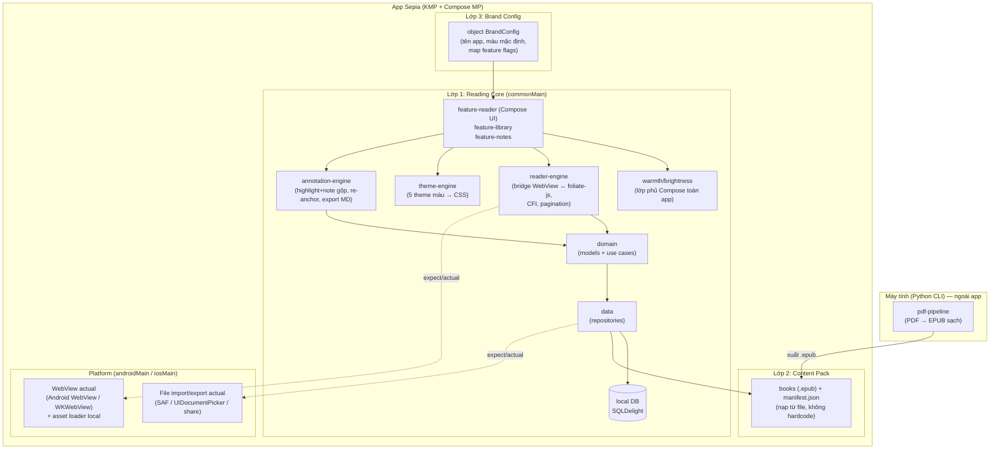

# 02 — Kiến trúc (Architecture)

> Cập nhật: 2026-10-26. Số phiên bản xem [05-tech-decisions.md](./05-tech-decisions.md).

## 1. Nguyên tắc kiến trúc

Tách **3 lớp** để sau này nhân bản thành nhiều biến thể app, nhưng **KHÔNG xây "nền tảng cho mọi thứ"** ngay. Chỉ giữ ranh giới sạch để tách ra được:

1. **Reading Core (lõi đọc dùng chung)** — logic đọc sách, theme, highlight/note, data layer. Không biết gì về "Đông y".
2. **Content Pack (gói nội dung)** — sách + metadata, tách rời khỏi code. App không hardcode sách.
3. **Brand Config (cấu hình thương hiệu + feature flags)** — tên app, màu mặc định, bật/tắt tính năng. **Giai đoạn đầu chỉ là một object `BrandConfig`** (Gradle flavors / Xcode targets **để sau** khi làm app thứ hai — xem ADR-007).

Tuân thủ **Clean Architecture** nhẹ (domain không phụ thuộc framework), nhưng không over-engineer cho app một người dùng.

## 2. Quyết định nền tảng cốt lõi (tóm tắt, chi tiết ở ADR)

- **KMP + Compose Multiplatform**, UI chung ở `commonMain`.
- **Bộ hiển thị EPUB**: **foliate-js chạy trong WebView** (qua `compose-webview-multiplatform`) — một renderer dùng chung cho cả Android + iOS. (Readium là phương án dự phòng — xem ADR-001.)
- **Theme màu chữ/nền**: CSS injection vào WebView. **Độ ấm / độ sáng**: **lớp phủ Compose phủ toàn app** (không trong WebView — xem C4 §8).
- Lý do chọn WebView+foliate-js: **một đường render duy nhất** cho 2 nền tảng, tránh tích hợp 2 toolkit native và viết Swift khi bạn chưa từng build iOS.

## 3. Sơ đồ module (Mermaid)



## 4. Cấu trúc thư mục KMP (đề xuất)

```
sepia/
├── docs/                         # tài liệu thiết kế
├── pdf-pipeline/                 # Python CLI, KHÔNG thuộc app KMP
│   ├── pyproject.toml
│   ├── sepia_pipeline/
│   │   ├── inventory.py          # SPIKE-0: quét & phân loại kho PDF
│   │   ├── detect.py             # phát hiện text/scan/font cũ (theo span)
│   │   ├── legacy_encoding.py    # TCVN3/VNI → Unicode (sau trích, theo span)
│   │   ├── extract.py            # PyMuPDF (bắt buộc cho font cũ) / Docling
│   │   ├── reflow.py             # ghép đoạn, bỏ header/footer (không de-hyphen)
│   │   ├── toc.py                # nhận diện tiêu đề → mục lục
│   │   ├── build_epub.py         # ebooklib + CSS font (serif + CJK fallback)
│   │   └── quality.py            # kiểm tra nhẹ (ký tự rác, số đoạn…)
│   └── tests/
│
├── composeApp/                   # app KMP
│   └── src/
│       ├── commonMain/           # ★ phần lớn code ở đây
│       │   └── kotlin/.../sepia/
│       │       ├── domain/       # models, use cases (thuần Kotlin)
│       │       ├── data/         # repositories, DB, file access (interface)
│       │       ├── reader/       # reader-engine: bridge WebView↔foliate-js, CFI, re-anchor
│       │       ├── theme/        # theme-engine: 5 theme màu → CSS
│       │       ├── overlay/      # warmth/brightness: lớp phủ Compose
│       │       ├── annotation/   # highlight(+note), export Markdown
│       │       └── feature/      # UI Compose: reader, library, notes
│       ├── androidMain/          # WebView actual + WebViewAssetLoader, SAF, entry Activity
│       ├── iosMain/              # WKWebView actual + WKURLSchemeHandler, UIDocumentPicker, entry
│       └── commonMain/composeResources/
│           └── foliate/          # foliate-js (vendored, pin SHA) + reader.html + bridge.js + CSS theme
│
├── CLAUDE.md                     # hướng dẫn cho AI/người làm
└── gradle/ (libs.versions.toml)  # version catalog tập trung
```

> Giai đoạn đầu gộp tất cả trong `composeApp` (ranh giới bằng **package**), chưa cần tách Gradle module. Khi lõi ổn định và nhân bản app, mới tách `:core`, `:brand-*`.

## 5. Luồng dữ liệu: PDF → EPUB → màn hình đọc

```mermaid
sequenceDiagram
    participant U as Bạn (máy tính)
    participant PY as pdf-pipeline (Python)
    participant FILE as File .epub
    participant APP as App (Kotlin)
    participant WV as WebView + foliate-js
    participant DB as Local DB

    U->>PY: chạy script với 1 file PDF
    PY->>PY: detect theo span (text/scan/font cũ)
    PY->>PY: trích chữ → chuyển TCVN3/VNI theo span → Unicode
    PY->>PY: reflow (ghép đoạn) + TOC
    PY->>PY: trang ảnh (huyệt vị/bảng) → nhúng dạng image
    PY->>FILE: xuất .epub sạch (đọc thử bằng KOReader — nhánh Pipeline)
    U->>APP: nhập .epub (SAF/UIDocumentPicker) → copy vào app
    APP->>APP: đọc dc:identifier → bookUid; tính contentHash
    alt bookUid đã có (build lại cùng cuốn)
        APP->>DB: thay file, cập nhật contentHash/pipelineVersion
        APP->>WV: nạp sách + yêu cầu re-anchor (search prefix+snippet+suffix)
        WV->>APP: (bridge) CFI mới cho vị trí đọc + từng Highlight
        APP->>DB: cập nhật positionCfi + cfiRange; cái nào fail → status=orphan
    else bookUid mới
        APP->>DB: tạo Book mới (bookUid, metadata, filePath, contentHash, pipelineVersion)
    end
    U->>APP: mở sách
    APP->>WV: nạp foliate-js + .epub (qua asset loader local) + CSS theme
    WV->>APP: (bridge kmpJsBridge) báo vị trí hiện tại dạng CFI
    APP->>DB: cập nhật Book.positionCfi + positionSnippet/prefix/suffix + progress
    U->>WV: chọn đoạn → highlight / ghi chú
    WV->>APP: (bridge) trả CFI range + prefix/suffix của vùng chọn
    APP->>DB: lưu Highlight (cfiRange, textSnippet, prefix, suffix, contentHash)
    U->>APP: xuất ghi chú / sao lưu
    APP->>FILE: ghi .md (share/SAF) + xuất file DB
```

## 6. Cơ chế expect/actual (phần native tối thiểu) — B1, B3

| Chức năng | commonMain (expect) | androidMain (actual) | iosMain (actual) |
|-----------|---------------------|----------------------|-------------------|
| WebView hiển thị | `ReaderWebView` composable | Android `WebView` | `WKWebView` |
| **Nạp EPUB local vào WebView (B3)** | `ReaderContentServer` | **`WebViewAssetLoader`** phục vụ qua `https://appassets/...` (tránh CORS `file://`); cấu hình qua `onCreated` → raw WebView | **`WKURLSchemeHandler`** custom scheme (lưu ý phải đăng ký *trước* khi tạo WKWebView → có thể cần tùy biến factory — rủi ro spike) |
| **Nhập file EPUB (B1)** | `FilePicker.pickEpub()` | **SAF** `ACTION_OPEN_DOCUMENT` → copy vào `filesDir` | **`UIDocumentPicker`** → copy vào Documents |
| **Xuất Markdown (B1)** | `FileExporter.exportMarkdown()` | **SAF** `ACTION_CREATE_DOCUMENT` hoặc share sheet | **share sheet**; bật `UIFileSharingEnabled` + `LSSupportsOpeningDocumentsInPlace` để hiện trong app Files |
| **Xuất file DB (B1, sao lưu)** | `FileExporter.exportDatabase()` | SAF / share | share sheet / Files |
| Đường dẫn lưu nội bộ | `AppPaths` | `Context.filesDir` *(người dùng không xem trực tiếp được)* | Documents |
| DB driver | (SQLDelight driver) | Android driver | Native driver |

> **Về nạp file local (B3)**: `compose-webview-multiplatform` **không** tích hợp sẵn `WebViewAssetLoader` (Android) hay `WKURLSchemeHandler` (iOS) — mặc định nạp qua `file://` nên foliate-js (dùng fetch/Blob) **dễ dính chặn CORS**. Thư viện **có** cho truy cập raw WebView qua callback `onCreated(NativeWebView)` và **có JS bridge hai chiều** (`kmpJsBridge`: `callNative`+`onCallback`, `evaluateJavaScript`) rất hợp để bắc cầu foliate-js. → Ta **tự cấu hình** asset loader/scheme handler qua raw WebView. Chi tiết & rủi ro: [05-tech-decisions.md](./05-tech-decisions.md) ADR-001, [06-risks.md](./06-risks.md) R-01. Mục tiêu NFR-5: giữ danh sách `actual` ngắn, ổn định.

> **Re-anchor chạy trong JS (R2-3, ADR-008)**: việc định vị lại highlight/vị trí đọc khi EPUB build lại được làm **trong WebView** bằng `search` của foliate-js (gọi qua bridge), **không** viết parser EPUB phía Kotlin. Kotlin chỉ giữ neo (snippet/prefix/suffix) và điều phối. Chuẩn hóa **NFC + gộp khoảng trắng** trước khi so khớp. Xem [04-data-model.md](./04-data-model.md) §3.1.

## 7. Ranh giới "dễ nhân bản" cụ thể

- **Reading Core không import** bất cứ thứ gì thuộc "Đông y". Từ điển huyệt/Hán Việt (giai đoạn sau) nằm ở lớp content/feature bật bằng flag trong `BrandConfig`.
- **Content Pack** = thư mục `.epub` + `manifest.json` (tiêu đề, tác giả, thứ tự). App đọc manifest, không hardcode.
- **Brand Config** = object `BrandConfig` (tên app, màu mặc định, map feature flags). Giai đoạn đầu **chưa** dùng Gradle flavors/Xcode targets — chỉ thêm khi thực sự làm app thứ hai (ADR-007). Thêm app mới lúc đó = thêm flavor/target + content pack, không sửa lõi.

## 8. Độ ấm & độ sáng: lớp phủ Compose (C4)

- Hiện thực bằng **một lớp phủ Compose** vẽ trên toàn bộ app (phía trên cả WebView), **không** can thiệp CSS trong WebView.
- **Độ ấm** = lớp phủ màu cam alpha thấp; **độ sáng** = lớp phủ tối alpha thấp.
- Lớp phủ phải **không chặn thao tác chạm** (dùng modifier cho phép sự kiện xuyên qua, ví dụ không đặt `pointerInput` nuốt sự kiện) để lật trang/chọn chữ trong WebView vẫn hoạt động.
- Lý do: tách khỏi renderer → độc lập với foliate-js, dễ chỉnh, đồng nhất trên cả 2 OS, không phụ thuộc quirk WebView.
