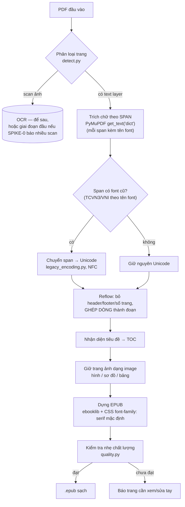

# 03 — PDF Pipeline (PDF → EPUB sạch)

> Chạy bằng **script Python trên máy tính** (giai đoạn đầu). Không chạy trên điện thoại.
> Phiên bản kiểm tra 2026-10. Đây là phần **rủi ro nhất** của dự án.
> Cập nhật: 2026-10-26.

## 0. Kiểm tra sách mẫu bằng `detect` (SPIKE-0)

**Làm đầu tiên**, trước khi đi sâu vào các bước sau:

- Chạy lệnh **`detect`** trên **vài cuốn sách mẫu** (đại diện các loại trong kho) đặt trong `samples/`, phân loại mỗi cuốn theo trang/span: `text_unicode | legacy_tcvn3 | legacy_vni | legacy_other | scan | empty | mixed`, in **phân bố theo trang** + tên font legacy. Lệnh nhận **danh sách file** (không tự quét thư mục, không làm báo cáo tổng hợp).
  ```bash
  cd pdf-pipeline && uv run python -m sepia_pipeline detect samples/*.pdf
  ```
- Quy ước thư mục mẫu (đã có trong `.gitignore`):
  ```
  samples/            # sách mẫu để thử pipeline (KHÔNG commit — có thể dính bản quyền)
  ```
- **Cửa quyết định (ảnh hưởng US-A7)**: nếu **scan chiếm phần lớn** các sách mẫu, nâng **OCR (US-A7)** từ "để sau" lên **giai đoạn đầu** (cập nhật [01-requirements.md](./01-requirements.md) §3, [06-risks.md](./06-risks.md) R-11, [07-roadmap.md](./07-roadmap.md)). Nếu scan ít, giữ OCR ở giai đoạn sau. *(Mẫu ít nên đây là tín hiệu định hướng, không phải thống kê toàn kho — gặp nhiều scan thì bổ sung thêm mẫu rồi chạy lại `detect`.)*

## 1. Mục tiêu

Biến một PDF thành **EPUB reflow sạch**, dấu tiếng Việt đúng, **chữ Hán hiển thị được** (nếu sách có chèn), có mục lục, giữ được trang ảnh (hình/sơ đồ/bảng). Chấp nhận **bán tự động**: script làm phần nặng, bạn kiểm tra tay vài chỗ. EPUB phải **đọc tốt bằng app EPUB có sẵn** (KOReader…) để kiểm chứng ngay (nhánh Pipeline — xem [07-roadmap.md](./07-roadmap.md)).

## 2. Kiến trúc pipeline (thứ tự bước đã sửa)

> **Sửa quan trọng**: việc chuyển mã TCVN3/VNI **KHÔNG** đứng trước bước trích chữ. Phải trích chữ trước rồi **chuyển mã theo từng span dựa trên tên font của span đó**. Lý do: cùng một trang có thể trộn nhiều font (một số span font cũ, một số Unicode).



## 3. Bước 1 — Phát hiện loại PDF & font (`detect.py`)

Dùng **PyMuPDF (fitz)** `1.27.x`. Với mỗi trang:

- **Text vs scan**: `page.get_text()` rỗng/gần rỗng + `page.get_images()` có ảnh full-trang ⇒ trang scan. Dùng ngưỡng *số ký tự text / trang*.
- **Font cũ (TCVN3/VNI)** — hai lớp heuristic để chắc hơn:
  1. **Tên font** từ `page.get_fonts()` / span `font`. Regex phải **xử lý tiền tố subset** dạng `ABCDEF+` (6 chữ in hoa + `+`):
     - TCVN3/ABC: `(?:[A-Z]{6}\+)?\.?Vn[A-Za-z]*` → `.VnTime`, `.VnArial`, `ABCDEF+.VnTime`
     - VNI: `(?:[A-Z]{6}\+)?VNI-[A-Za-z]*`
     - VPS/VISCII: họ font riêng
  2. **Thống kê ký tự bất thường**: đếm tỷ lệ ký tự rơi vào dải/pattern đặc trưng của TCVN3/VNI trong chữ trích ra (bắt được cả font **bị đổi tên** không khớp regex). Nếu tỷ lệ cao → đánh dấu legacy dù tên font "sạch".
- Kết quả: mỗi **span** gắn nhãn encoding → quyết định có chuyển mã không ở bước 2.

> **Vì sao quan trọng**: PDF font cũ *vẫn có text layer* nhưng rút ra là **byte rác**. Nếu không phát hiện theo span, EPUB sẽ lẫn ký tự lỗi.

## 4. Bước 2 — Chuyển TCVN3/VNI → Unicode theo span (`legacy_encoding.py`) — US-A3

Chạy **sau khi trích** (không chạy trước). Với mỗi span được gắn nhãn legacy, áp bảng chuyển tương ứng rồi **chuẩn hóa NFC**.

**Thực trạng (trung thực): KHÔNG có package Python turnkey đáng tin.** Kế hoạch:
- **Port bảng chuyển đổi** vào `dict` Python từ:
  - `vietnameseConverter` (R, CRAN v0.4.0): `decodeVN()` hỗ trợ **TCVN3, VISCII, VPS**. **Không có VNI.**
  - **VietUnicode** (SourceForge): có bảng **VNI, VPS, VISCII, TCVN3(ABC), VIQR** — port bảng **VNI** từ đây (phần FOSS ít phủ nhất).
- Xử lý **dấu kết hợp**, rồi NFC.
- **🔬 SPIKE-3** (xem [06-risks.md](./06-risks.md)): chuyển 1 trang TCVN3 + 1 trang VNI từ sách thật, **so dấu bằng mắt** trước khi tin cả pipeline.

## 5. Bước 3 — Ràng buộc chọn công cụ trích (ADR-004)

- **Sách/trang có font cũ → BẮT BUỘC PyMuPDF** `get_text("dict")`, vì nó trả **tên font theo từng span** (cần cho bước 2). **Docling KHÔNG giữ font theo span** nên **không dùng được** cho loại này.
- **Sách Unicode phức tạp** (nhiều cột, nhiều bảng) → có thể dùng **Docling** để dựng reading order/heading/bảng tốt hơn.
- Mặc định PyMuPDF; Docling chỉ cho sách Unicode nhiều cột/bảng. (Chi tiết [05-tech-decisions.md](./05-tech-decisions.md) ADR-004.)

## 6. Bước 4 — Reflow (`reflow.py`) — US-A4 (đã đơn giản hóa)

- **Bỏ header/footer/số trang**: phát hiện block lặp lại ở cùng vị trí y trên nhiều trang (so string similarity); regex xóa dòng chỉ gồm số ở mép trang.
- **Ghép dòng thành đoạn**: nối dòng trừ khi dòng kết thúc bằng dấu câu kết thúc.
- **KHÔNG làm de-hyphenation phức tạp** (xem [06-risks.md](./06-risks.md) R-04): **tiếng Việt viết rời từng âm tiết**, hầu như **không có từ bị ngắt bằng gạch nối cuối dòng** như tiếng Âu. → **Bỏ `pd3f`/`dehyphen`/`malti`/`prettyparser`** khỏi kế hoạch (giảm phụ thuộc, NFR-4).
- ⚠️ **Cảnh báo**: **không xóa nhầm gạch ngang/gạch nối thật** (dấu gạch trong liệt kê, tên ghép, số…). Chỉ ghép dòng, không "chữa" gạch nối.

## 7. Bước 5 — Mục lục & Bước 6 — Giữ trang ảnh

- **TOC** (`toc.py`): suy heading từ cỡ chữ/độ đậm/vị trí → `<h1>/<h2>`; foliate-js & app EPUB khác tự dựng TOC từ heading + `nav.xhtml`.
- **Trang ảnh** (US-A6): trang gắn nhãn "ảnh" (hình, sơ đồ, bảng) → render **nguyên trang thành ảnh** nhúng vào EPUB. **Không** cố reflow bảng/sơ đồ. (Chức năng xem lại PDF gốc trong app → giai đoạn sau, US-F4.)

## 8. Bước 7 — Dựng EPUB + font + kiểm tra nhẹ

### Dựng EPUB & font (một nguồn quyết định font là app)
- **`ebooklib`** từ HTML sạch — **không** dùng Calibre `ebook-convert` PDF→EPUB trực tiếp (reflow kém). Calibre `9.x` chỉ là fallback/tiện ích.
- **Định danh sách ổn định**: ghi **`dc:identifier` cố định** vào EPUB = **`sepia:` + SHA-256 của PDF gốc**. Giá trị này **không đổi giữa các lần build lại** cùng một PDF → app dùng làm `Book.bookUid` để nhận ra "cùng một cuốn" khi nhập bản EPUB mới và chạy re-anchor (xem [04-data-model.md](./04-data-model.md) §6). *Lưu ý*: hash theo **PDF gốc**, không theo file EPUB (EPUB đổi mỗi lần build).
- **Font do app quyết định, không phải pipeline** (một nguồn duy nhất): trong app Sepia, font được **app chèn qua CSS vào WebView** theo **danh sách fallback trong `VariantConfig`** của biến thể (xem [01-requirements.md](./01-requirements.md) US-C3, [02-architecture.md](./02-architecture.md) §7). Vì vậy pipeline **không** tự chốt tên font:
  - **Mặc định pipeline chỉ ghi `font-family: serif`** vào CSS của EPUB — **không** ghi tên font cụ thể, để không đá nhau với font app áp lúc đọc:
    ```css
    /* Mặc định: chỉ serif chung; app/biến thể mới quyết định font thật */
    body { font-family: serif; }
    ```
  - **Tùy chọn `--font-profile <tên>`**: chỉ dùng khi muốn **đọc thử bằng app EPUB khác** (KOReader…) với font đẹp — cờ này ghi **tên font cụ thể** vào CSS của EPUB. Danh sách profile lấy từ một **file cấu hình nhỏ trong `pdf-pipeline/`** (vd `font_profiles.toml`), **không hardcode** trong code. Ví dụ profile `dongy` (ưu tiên phồn thể): `"Literata", "Noto Serif", "Noto Serif CJK TC", "Noto Serif CJK SC", serif` (xem [variants/dongy.md](./variants/dongy.md)).
  - **Font dự phòng theo hệ chữ (script fallback)** là yêu cầu **chung** nhưng áp **ở phía app**: nhiều sách tiếng Việt có chèn chữ Hán, mà font serif Latin (Literata) **không có glyph CJK** → thiếu fallback sẽ mất chữ (US-C3). App cấu hình fallback gồm **cả phồn thể (TC) lẫn giản thể (SC)** + font CJK hệ thống; biến thể có thể đổi thứ tự ưu tiên (vd biến thể Đông y ưu tiên TC — xem [variants/dongy.md](./variants/dongy.md)).
  - Font CJK **rất nặng** → app **cân nhắc KHÔNG nhúng mà dùng font CJK hệ thống** của thiết bị (Android/iOS đều có sẵn), chỉ nhúng font serif Latin/Việt. Nếu nhúng (kể cả qua `--font-profile`), **kiểm tra kích thước file EPUB**.

### Kiểm tra chất lượng nhẹ (`quality.py`)
Giai đoạn đầu **không** làm ground-truth + CER/NED (quá nặng cho một người). Thay bằng các **kiểm tra nhẹ, tự động**:
- Số **ký tự rác / ký tự ngoài bảng chữ tiếng Việt** (bắt sót font cũ chưa chuyển). **Whitelist dải CJK** để không đếm nhầm chữ Hán là "rác" (nhiều sách tiếng Việt có chèn chữ Hán): `U+4E00–U+9FFF` (CJK Unified), `U+3400–U+4DBF` (Extension A), `U+F900–U+FAFF` (CJK Compatibility Ideographs); cùng với chữ Việt (Latin + dấu) và dấu câu thông dụng.
- Số **đoạn (paragraph)** và **độ dài đoạn bất thường** (quá ngắn/quá dài → nghi ghép dòng sai).
- Chuẩn hóa **NFC** nhất quán.
- Sau đó **tự đọc kiểm tra ngẫu nhiên N trang** (sanity check của người).

> **Nếu thương mại hóa về sau**: mới nâng lên đo **CER/NED**, **reading-order edit distance**, khung **OmniDocBench / olmOCR-bench**, và kiểm dấu tiếng Việt chuyên sâu.

## 9. Bảng công cụ & license (kiểm tra 2026-10)

| Công cụ | Phiên bản | License | Vai trò | Ghi chú |
|---------|-----------|---------|---------|---------|
| PyMuPDF (fitz) | 1.27.2.x | **AGPL-3.0** / commercial | Trích chữ theo span + detect + tên font; **bắt buộc cho font cũ** | Dùng cá nhân/offline, **không phân phối** → AGPL OK. Bán sau → cân nhắc (xem ADR-004, R-08) |
| Docling | ~2.130 | **MIT** | Trích cấu trúc/bảng cho **sách Unicode** nhiều cột | **Không** dùng cho font cũ (không giữ font theo span) |
| Marker (`marker-pdf`) | 2.0.0 | Apache-2.0 (code); weights trả phí nếu doanh thu/vốn > $2M | Trích chất lượng cao, OCR | Cá nhân miễn phí; GPU khuyến nghị |
| Calibre | 9.x | GPL-3.0 | Fallback/tiện ích | Không dùng PDF→EPUB trực tiếp |
| ebooklib | mới nhất | AGPL-3.0 | Dựng EPUB từ HTML | Kiểm tra lại license trước khi phân phối |
| `vietnameseConverter` (R) | 0.4.0 | nguồn bảng TCVN3/VISCII/VPS | Port bảng sang Python | Không có VNI |
| VietUnicode | — | nguồn bảng VNI/TCVN3/VPS/VISCII | Port bảng VNI | Standalone, không phải lib |
| OCRmyPDF + Tesseract | 16.x / 5.5.3 | MPL / Apache | OCR (US-A7), `vie` | Font cũ/scan mờ: cân nhắc Surya/PaddleOCR |

> **License (R-08)**: PyMuPDF + ebooklib đều **AGPL**. Pipeline chạy **tách rời**, chỉ xuất `.epub`, nên app KMP (nếu bán sau) **không link** AGPL. Giữ ranh giới này (ADR-004).
