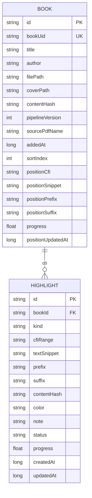

# 04 — Mô hình dữ liệu (Data Model)

> Cập nhật: 2026-10-26. Lưu local, offline. Quyết định DB engine ở [05-tech-decisions.md](./05-tech-decisions.md) ADR-002.

## 1. Tổng quan thực thể (đã đơn giản hóa)

Giai đoạn đầu **gộp mạnh** để một người dễ bảo trì:
- `Note` **gộp vào** `Highlight` (trường `note` có thể rỗng).
- Bookmark / ghi chú rời = `Highlight` với `kind` tương ứng (không bắt buộc có đoạn tô).
- `ReadingPosition` **gộp thành cột** trong `Book`.
- **Bỏ** `Tag`/`Topic` khỏi schema lúc đầu — sẽ thêm khi làm US-F1 (gom ghi chú theo chủ đề).



## 2. Chi tiết các thực thể

### Book
Metadata một cuốn sách + vị trí đọc hiện tại. **Không** nhúng nội dung — nội dung nằm trong file `.epub` (Content Pack).

| Trường | Kiểu | Ý nghĩa |
|--------|------|---------|
| `id` | String (UUID) | Khóa chính nội bộ |
| `bookUid` | String (unique) | **Định danh sách ổn định** do pipeline sinh = `dc:identifier` trong EPUB (vd `sepia:` + SHA-256 của **PDF gốc**). **Không đổi giữa các lần build lại** → dùng để nhận ra "cùng một cuốn" khi nhập bản EPUB mới (xem §6) |
| `title`, `author` | String | Hiển thị thư viện |
| `filePath` | String | Đường dẫn `.epub` đã copy vào bộ nhớ app |
| `coverPath` | String? | Ảnh bìa |
| `contentHash` | String | Hash nội dung file EPUB (vd SHA-256 của **file EPUB**). **Dùng để phát hiện EPUB đã bị build lại** → quyết định có tin CFI không (xem §3). *Khác `bookUid`*: contentHash đổi mỗi lần build, bookUid thì không |
| `pipelineVersion` | Int | Phiên bản pipeline đã tạo EPUB này — truy vết khi reflow đổi cấu trúc |
| `sourcePdfName` | String? | **Chỉ tên** file PDF gốc (metadata). *Không* lưu đường dẫn máy tính — điện thoại không có file đó |
| `addedAt` | Long (epoch ms) | Ngày thêm, để sắp xếp |
| `sortIndex` | Int | Thứ tự người dùng kéo-thả |
| `positionCfi` | String? | **Vị trí đọc hiện tại** dạng EPUB CFI (gộp từ ReadingPosition cũ) |
| `positionSnippet` | String? | Đoạn text ngay tại vị trí đọc — để **re-anchor vị trí đọc** khi build lại EPUB |
| `positionPrefix` | String? | ~32 ký tự trước vị trí đọc (W3C `TextQuoteSelector`) |
| `positionSuffix` | String? | ~32 ký tự sau vị trí đọc |
| `progress` | Float | 0.0–1.0, hiện % tiến độ (US-E3); cũng là phao thô khi re-anchor |
| `positionUpdatedAt` | Long | Lần cập nhật vị trí gần nhất |

### Highlight (gộp cả Note, Bookmark)
| Trường | Kiểu | Ý nghĩa |
|--------|------|---------|
| `id` | String (UUID) | Khóa chính |
| `bookId` | FK → Book | |
| `kind` | String (enum) | `highlight` \| `note` \| `bookmark`. `bookmark` và `note` rời có thể có `cfiRange` độ dài 0 (một điểm neo) |
| `cfiRange` | String | Vùng tô dạng CFI range (hoặc điểm neo cho bookmark/note rời) |
| `textSnippet` | String | **Bản sao text** được tô — nền tảng để re-anchor + xuất Markdown kể cả khi CFI lỗi |
| `prefix` | String | ~32 ký tự **trước** đoạn (kiểu W3C `TextQuoteSelector`) — giúp định vị lại chính xác |
| `suffix` | String | ~32 ký tự **sau** đoạn |
| `contentHash` | String | Hash EPUB lúc tạo highlight — so với `Book.contentHash` để biết CFI còn đáng tin không |
| `color` | String | Tên màu trong bảng màu highlight (nhiều màu — US-D1) |
| `note` | String? | Nội dung ghi chú gõ phím (US-D2); rỗng nếu chỉ tô màu |
| `status` | String (enum) | `active` \| `orphan` (mồ côi — không re-anchor được nhưng **không xóa**) |
| `progress` | Float | Vị trí thô 0.0–1.0 để tìm gần đúng khi re-anchor |

## 3. Định vị bền vững & khôi phục (re-anchoring)

**Vấn đề 1 — đổi hiển thị**: đổi cỡ chữ/giãn dòng/lề làm pixel/trang đổi. → Dùng **EPUB CFI** (neo theo cấu trúc tài liệu, không theo hiển thị). foliate-js có sẵn parser CFI (↔ DOM Range). Đổi cỡ chữ không làm CFI sai.

**Vấn đề 2 — build lại EPUB (rủi ro thật của dự án)**: pipeline sẽ còn chỉnh nhiều lần; mỗi lần build lại, **cấu trúc EPUB có thể đổi → CFI cũ trỏ sai**. Nếu chỉ dựa CFI, highlight **và vị trí đọc** sẽ trôi hoặc mất. Vì vậy:
- mỗi **Highlight** lưu thêm `textSnippet` + `prefix` + `suffix` + `contentHash`;
- **Book** lưu thêm `positionSnippet` + `positionPrefix` + `positionSuffix` cho **vị trí đọc**.

Cả hai dùng **chung một thuật toán re-anchor** dưới đây (vị trí đọc coi như một neo điểm độ dài 0).

**Thuật toán khôi phục vị trí (re-anchor) khi mở sách:**

```text
1. Nếu Highlight.contentHash == Book.contentHash:
   → EPUB không đổi, DÙNG THẲNG cfiRange.
2. Ngược lại (EPUB đã build lại), tìm trong nội dung sách chuỗi:
   prefix + textSnippet + suffix  (khớp đúng)
   → nếu thấy: tính lại cfiRange mới, cập nhật contentHash, status = active.
3. Nếu không thấy chuỗi đầy đủ: tìm GẦN ĐÚNG textSnippet quanh vị trí `progress`
   (cửa sổ lân cận), chọn khớp tốt nhất vượt ngưỡng tương đồng.
   → nếu đạt: cập nhật cfiRange + contentHash, status = active.
4. Vẫn thất bại: ĐÁNH DẤU status = "orphan".
   → KHÔNG xóa. Vẫn hiển thị trong danh sách ghi chú và VẪN XUẤT ra Markdown.
```

> Nguyên tắc: **không bao giờ mất ghi chú** (NFR-3). Highlight mồ côi vẫn còn text + ghi chú của người dùng; chỉ là không nhảy được tới đúng chỗ trong sách. Vị trí đọc mồ côi → mở lại ở đầu chương gần nhất theo `progress`. Xem [06-risks.md](./06-risks.md) R-07.

### 3.1 Nơi chạy re-anchor (ADR-008)

**Quyết định: chạy trong JS bằng `search` của foliate-js, gọi qua bridge** — **không** viết parser EPUB phía Kotlin. Lý do:
- foliate-js đã có sẵn bộ máy duyệt nội dung + CFI; tìm chuỗi `prefix+snippet+suffix` và quy ra CFI nằm **trong WebView** là tự nhiên nhất, tránh thêm một parser EPUB (zip + XHTML) ở Kotlin (NFR-4, ít phụ thuộc).
- Kotlin chỉ giữ dữ liệu neo (snippet/prefix/suffix/contentHash/progress) và điều phối; WebView trả CFI mới qua `kmpJsBridge`.
- **Chuẩn hóa trước khi so khớp**: **NFC** + **gộp khoảng trắng** (nhiều space/newline → một space) ở cả chuỗi lưu lẫn nội dung sách, để không trượt vì khác cách xuống dòng/thụt lề giữa các bản build.
- Xem [02-architecture.md](./02-architecture.md) §6, [05-tech-decisions.md](./05-tech-decisions.md) ADR-008, và checklist SPIKE-1 ([06-risks.md](./06-risks.md) R-01).

```kotlin
// domain — trừu tượng hóa cách neo, không phụ thuộc renderer cụ thể
data class TextAnchor(
    val cfiRange: String,      // dạng chính (foliate-js CFI; Readium Locator nếu đổi — ADR-001)
    val textSnippet: String,   // đoạn text (con người đọc được + để re-anchor)
    val prefix: String,        // ~32 ký tự trước (W3C TextQuoteSelector)
    val suffix: String,        // ~32 ký tự sau
    val contentHash: String,   // hash EPUB lúc tạo neo
    val progress: Float        // vị trí thô, phòng hờ
)
```

## 4. Định dạng xuất Markdown (US-D3, NFR-3)

Xuất **ngay từ bản đầu**. Một file `.md` mỗi sách (hoặc gộp), con người đọc được, không khóa trong app.

```markdown
# {Tên sách} — Ghi chú
> Tác giả: {author} · Xuất lúc: {ISO datetime} · pipelineVersion: {n}

## {Chương / vị trí} ({progress}%)

> {textSnippet được highlight}
<!-- meta: {"color":"vàng","kind":"highlight","status":"active","cfi":"epubcfi(/6/14!/4/2/2,/1:0,/1:40)","hash":"{contentHash}","prefix":"…","suffix":"…"} -->

**Ghi chú:** {note}

---

> {textSnippet của một highlight mồ côi}
<!-- meta: {"color":"xanh","kind":"highlight","status":"orphan","hash":"{contentHash cũ}","progress":0.62} -->
<!-- ORPHAN: không định vị được trong bản EPUB hiện tại -->

**Ghi chú:** {note}
```

> Các trường trong `meta:` được **JSON-encode** (xem quy tắc escape bên dưới) để `--`/`-->` trong text không làm vỡ comment.

Quy ước:
- Mỗi highlight là một blockquote; ghi chú đi kèm ngay dưới.
- HTML comment chứa `color/kind/status/cfi/hash/prefix/suffix` → đủ để **import ngược** và để re-anchor lại kể cả từ file Markdown.
- Highlight `orphan` vẫn được xuất, có nhãn rõ ràng.
- Sắp theo `progress`/CFI (thứ tự xuất hiện trong sách).
- **Escape trong HTML comment**: nội dung `prefix/suffix/snippet/cfi` có thể chứa cặp gạch nối (`-` liền `-`) hoặc chuỗi đóng comment làm **vỡ** HTML comment. → **JSON-encode** các trường này trước khi nhét vào comment (JSON tự escape dấu ngoặc kép, newline…); thêm bước thay mỗi gạch nối còn sót bằng dạng escape `-` cho chắc. Khi import ngược thì JSON-decode. Ví dụ: `<!-- meta: {"color":"vàng","cfi":"epubcfi(...)","prefix":"...","suffix":"..."} -->`.

## 5. Lưu trữ vật lý & sao lưu (NFR-3)

- DB và file `.epub`/`.md` nằm trong **vùng lưu trữ riêng của app** (`filesDir` trên Android, Documents trên iOS). **Lưu ý**: `filesDir` trên Android **người dùng không mở xem trực tiếp được** bằng app Files — nên không gọi là "thư mục thấy được".
- Vì vậy, **sao lưu = xuất chủ động ra ngoài** (xem [02-architecture.md](./02-architecture.md) bảng expect/actual):
  - **Xuất Markdown** qua share sheet / trình chọn nơi lưu (Android `ACTION_CREATE_DOCUMENT`/share; iOS share sheet).
  - **Xuất cả file DB** (không chỉ Markdown) ra ngoài để sao lưu toàn bộ highlight/vị trí.
  - iOS có thể bật `UIFileSharingEnabled` + `LSSupportsOpeningDocumentsInPlace` để thư mục Documents hiện trong app Files (tùy chọn).
- Ghi DB **transactional** (không mất khi crash giữa chừng). Giai đoạn đầu **không** cloud sync — đường thoát dữ liệu = Markdown + xuất DB + copy file.

## 6. Nhập sách & khử trùng theo `bookUid`

Pipeline ghi **`dc:identifier` cố định** vào EPUB (vd `sepia:` + SHA-256 của **PDF gốc**) — **không đổi giữa các lần build lại**. App đọc giá trị này thành `Book.bookUid`. Nhờ đó, khi bạn build lại một cuốn (sửa pipeline) rồi nhập bản mới, app biết đây là **cùng một cuốn** chứ không phải sách mới.

**Luồng nhập một file EPUB:**

```text
1. Đọc dc:identifier từ EPUB → bookUid. Tính contentHash (hash file EPUB).
2. Tra DB theo bookUid:
   a. TRÙNG bookUid (đã có cuốn này):
      - Thay file .epub cũ bằng file mới; cập nhật contentHash + pipelineVersion + metadata.
      - Chạy RE-ANCHOR (§3) cho:
        · vị trí đọc (positionCfi dựa positionSnippet/prefix/suffix), và
        · tất cả Highlight của cuốn (cfiRange dựa snippet/prefix/suffix).
      - Giữ nguyên toàn bộ Highlight/ghi chú; cái nào không re-anchor được → status = orphan (không xóa).
   b. KHÔNG trùng bookUid:
      - Tạo Book mới (id mới), lưu bookUid, chưa có highlight.
3. (Nếu EPUB thiếu dc:identifier dạng sepia: — sách cũ/bên ngoài) → coi như sách mới,
   đồng thời cảnh báo để người dùng biết re-anchor xuyên-build sẽ không hoạt động cho cuốn đó.
```

> Đây là mảnh ghép để **US-B2** (nhớ vị trí) và an toàn highlight (R-07) sống sót qua việc **build lại EPUB nhiều lần** — tình huống thường gặp khi vừa dùng vừa cải tiến pipeline. Xem [02-architecture.md](./02-architecture.md) §5 (sequence), [07-roadmap.md](./07-roadmap.md) Mốc 2.
