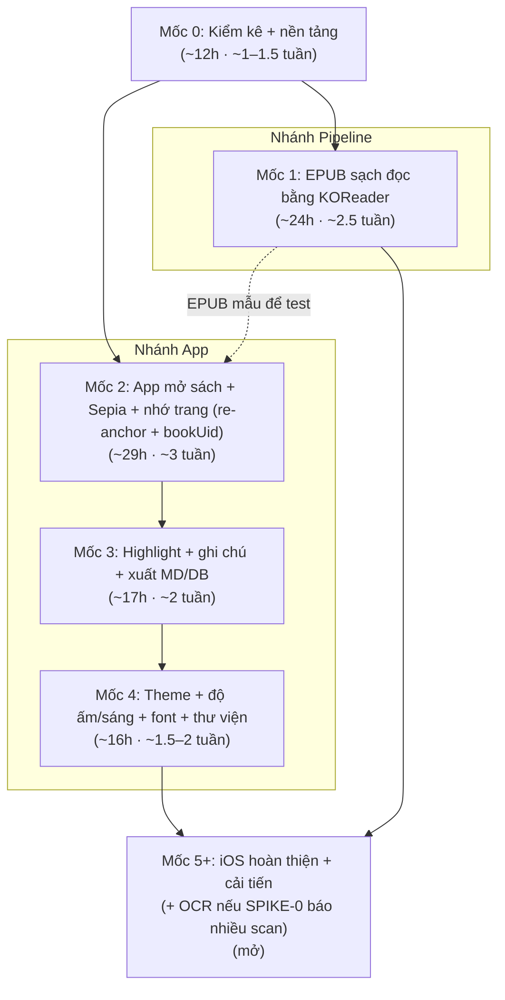

# 07 — Roadmap (kế hoạch theo mốc)

> ~10 giờ/tuần. Chia theo **mốc (milestone)**, mỗi mốc ghi **tổng giờ ước tính** và quy ra **số tuần** ở nhịp 10h/tuần. Mỗi đầu việc có ước tính giờ riêng.
> Nguyên tắc: **mỗi mốc ra một bản dùng được**.
> **Bạn chưa từng build iOS** → mọi việc iOS đã **cộng thêm giờ**.
> Cập nhật: 2026-10-26.

## Hai nhánh song song

- **Nhánh Pipeline**: EPUB xuất ra **đọc kiểm chứng ngay bằng app EPUB có sẵn** (KOReader / Google Play Books / Apple Books) — có giá trị dùng được *trước cả khi* app Sepia xong.
- **Nhánh App**: Sepia thay thế dần app đọc có sẵn.

Hai nhánh chạy xen kẽ (một người), nhưng **không phụ thuộc chặt**: bạn có thể đọc sách đã chuyển bằng KOReader trong khi app Sepia còn đang xây.

---

## Mốc 0 — Kiểm kê kho + nền tảng (gỡ rủi ro) · ~12h (~1–1.5 tuần)

> Không ra tính năng đọc, nhưng là mốc quan trọng nhất về rủi ro. **Bản dùng được** = báo cáo kho PDF + app KMP rỗng chạy 2 OS + quyết định OCR.

- [x] Dựng khung `pdf-pipeline` (uv, PyMuPDF 1.27.x) + `detect.py` (phân loại theo trang/span) + CLI `detect` + test. **2h**
- [x] Quy ước `samples/` + `.gitignore` (samples/ không commit; giữ `tests/fixtures/`). **0.5h**
- [ ] **SPIKE-0** — chạy `detect` trên **vài sách mẫu** (`samples/`), xem phân bố loại (R-11). **~0.5h**
- [ ] **Cửa quyết định OCR**: sách mẫu nhiều scan? → nâng US-A7 lên giai đoạn đầu. **0.5h**
- [x] **SPIKE-2** — app KMP + Compose MP (scaffold tay), build **Android** xanh và **đã chạy trên emulator** (màn hình mở đầu hiện "Sepia", nền sepia). **2h** — Kotlin 2.4.20 / CMP 1.12.2 / AGP 9.4.1 / Gradle 9.8.2; AGP 9 buộc tách `:androidApp` + `:composeApp` (xem [05 ADR-007](./05-tech-decisions.md#adr-007)). *(IDE: cần Android Studio 2026 ≥ Rabbit để sync AGP 9.)*
- [ ] SPIKE-2 (tiếp) — **iOS hoãn** sang việc riêng khi có Xcode: dựng `.xcodeproj` + chạy simulator. **5h** — xem **[issue #3](https://github.com/trinhvandat/sepia/issues/3)** (nên làm **trước phần iOS của SPIKE-1**; liên quan R-02).
- **Thành quả**: khung pipeline + `detect` chạy được, biết cơ cấu sách mẫu + OCR có phải làm sớm không; **app Android rỗng chạy được** (phần iOS hoãn — [issue #3](https://github.com/trinhvandat/sepia/issues/3)).

## Mốc 1 — Pipeline ra EPUB sạch, đọc bằng KOReader · ~24h (~2.5 tuần) · [Pipeline]

> **Bản dùng được**: bạn đọc được sách thật trong kho của mình ở chế độ reflow, chưa cần app Sepia.
>
> **Trạng thái**: **XONG cho sách `scan_ocr`** (Docling) — mẫu `Tự Học Đông Y - Bùi Huy.pdf` (scan
> ABBYY FineReader 11) ra EPUB **epubcheck hợp lệ, tất định**, độ phủ chữ **~96%**, 7 file XHTML,
> 2.7 MB, giữ 161 hình (PR #4 = Mốc 1a đã merge; PR #5 = Mốc 1b định tuyến + Docling). **Đường
> heuristic (sách born-digital chữ sạch) CHƯA kiểm trên sách thật** (chưa có mẫu loại này). **Chưa
> đọc thử bằng KOReader** — sẽ kiểm khi có MVP (Mốc 2). `convert` tự chọn engine theo nhãn `detect`
> (`text_unicode`/`legacy_*` → heuristic; `scan_ocr` → Docling).

- [~] **SPIKE-3** — chuyển mã TCVN3 so dấu bằng mắt (R-03). *Làm trên dữ liệu **tổng hợp** (`out/spike3_synthetic_tcvn3.txt`) vì `samples/` chưa có sách TCVN3/VNI thật; round-trip khớp 100%. VNI hoãn.*
- [x] `extract.py` trích **theo span** (PyMuPDF `get_text("dict", sort=True)`) + SHA-256 + `model.py`.
- [x] `legacy_encoding.py` — port bảng TCVN3 (libiconv, một nguồn), NFC, theo span. VNI chưa làm (không có mẫu).
- [x] `reflow.py` + `toc.py` — ghép đoạn (vắt trang), bỏ header/footer/số trang + **mục lục in sẵn**, heading (giới hạn độ dài/dòng), chia chương + cắt file theo kích thước. *(Hiệu chỉnh ngưỡng chữ-sạch chờ có mẫu + đọc KOReader.)*
- [x] `build_epub.py` (ebooklib 0.20) + **`dc:identifier` ổn định** + CSS `serif` (+ `--font-profile`) + trang ảnh (US-A6) + **EPUB tất định từng byte** + nén ảnh (JPEG q80/≤1200px).
- [x] `quality.py` kiểm nhẹ (whitelist CJK, % đoạn ngắn, độ phủ chữ) + **epubcheck**. **SPIKE-4** (so Docling) xong → chọn định tuyến theo engine. Xem [docs/spikes/spike-4-docling.md](./spikes/spike-4-docling.md).
- [x] **Định tuyến engine + Docling cho `scan_ocr`** (Mốc 1b): khôi phục chữ trong "picture", gộp chương, nén ảnh → độ phủ 75%→96%, file 721→7, EPUB 71MB→2.7MB.
- **Thành quả**: sách `scan_ocr` → EPUB đọc được, `bookUid` ổn định, hợp lệ/tất định. **Còn lại**: thêm **mẫu chữ sạch** để kiểm đường heuristic; **đọc thử KOReader** (làm cùng Mốc 2); VNI khi có mẫu.

## Mốc 2 — App mở sách + Sepia + nhớ trang (re-anchor + bookUid) · ~29h (~3 tuần) · [App]

> **Bản dùng được**: mở EPUB trong Sepia trên Android, đọc theme Sepia, nhớ đúng vị trí (kể cả sau khi build lại EPUB).
>
> **Trạng thái (2026-10-26): ĐẠT trên emulator Android (API 36).** `:androidApp:assembleDebug` + **19
> unit test** xanh; đã **kiểm thực tế** trên `emulator-5554`: nhập `dongy_docling.epub` qua SAF → thư
> viện hiện "Tự Học Đông Y - Bùi Huy"; mở sách → **foliate-js render EPUB tiếng Việt trên nền sepia**;
> **chạm phải → sang trang** (mục lục 1–24 → 26–45); **thoát rồi mở lại → đúng trang cũ** (nhớ vị trí qua
> SQLDelight, kể cả sau khi cài lại APK). → **Cửa quyết định ADR-001 ĐÓNG: giữ foliate-js.** iOS vẫn hoãn.
> *(Lưu ý: còn một cảnh báo JS `appendChild` benign từ lớp inject bridge của compose-webview-multiplatform;
> không chặn chức năng. Chọn chữ/highlight: nợ Mốc 3 — lớp chạm Compose chặn nhấn-giữ.)*

- [x] **SPIKE-1** — foliate-js (vendor pin SHA 78914ae, MIT; bỏ vendor/pdfjs, GIỮ vendor/zip.js + fflate.js)
  trong WebView + **tự cấu hình WebViewAssetLoader** (AssetsPathHandler `/assets/`, BookPathHandler
  `/books/` qua https appassets — tránh CORS `file://`), reader.html + bridge.js (open/goTo/next/prev/
  applyStyle/relocated/reAnchor; chờ kmpJsBridge + ping chống race). **ĐÃ chạy thật trên emulator.** **Android: 8h**
- [ ] SPIKE-1 (tiếp) — kiểm tra trên **iOS (WKURLSchemeHandler), time-box tối đa 6h**, không chặn Android; gồm **lớp phủ Compose đè WKWebView + chạm xuyên qua**. **6h** *(chưa làm — iOS hoãn, issue #3)*
- [x] `ReaderEngine` (ReaderController + ReaderEvent) + bridge `kmpJsBridge` (open, goTo, next/prev, applyStyle, reAnchor). Bọc foliate sau interface (ADR-001).
- [x] Nhập EPUB vào app (SAF `ACTION_OPEN_DOCUMENT`) + **đọc `dc:identifier`→bookUid, khử trùng/thay file theo bookUid** + lưu `Book` (bookUid, contentHash, pipelineVersion) — SQLDelight + Koin.
- [x] **Theme Sepia** qua CSS (foliate `renderer.setStyles`); chỉnh cỡ chữ cơ bản (A−/A+).
- [x] **Nhớ vị trí đọc** (Book.positionCfi + positionSnippet/prefix/suffix + progress, debounce ~1s + lưu khi rời) + **re-anchor trong JS** cho vị trí đọc (ADR-008: foliate `search` → chọn CFI gần `progress`, không thấy → `goToFraction`). Nhớ vị trí **đã kiểm trên emulator** (thoát/mở lại đúng trang). Highlight re-anchor để Mốc 3. *(Re-anchor xuyên-build chưa kiểm vì chưa có bản EPUB build-lại khác cấu trúc để nhập — kiểm khi pipeline đổi; logic + unit test chọn vị trí đã có.)*
- **Thành quả**: **dogfood được trên Android** (mở EPUB, đọc theme Sepia, lật trang, nhớ vị trí). Nhập bản EPUB build lại giữ vị trí đọc + re-anchor (logic sẵn, kiểm xuyên-build khi có mẫu).

## Mốc 3 — Highlight, ghi chú, xuất Markdown/DB · ~17h (~2 tuần) · [App]

> **Bản dùng được**: vừa đọc vừa đánh dấu & ghi chú, sao lưu được, không sợ mất dữ liệu.
>
> ✅ **Nợ kỹ thuật Mốc 2 đã gỡ (Mốc 3a)**: **bỏ hẳn lớp chạm Compose** (TapZone) phủ WebView — nó nuốt
> nhấn-giữ nên không chọn được chữ. Nay **cử chỉ do JS trong foliate**: paginator tự **vuốt** lật trang;
> bridge bắt **tap** đơn, quy về khung nhìn trang chủ (xử lý đúng cả trang ≥10 nhờ cộng
> `frameElement.getBoundingClientRect()`), báo `zone` 30/40/30 → Kotlin lật trước/sau + toggle thanh.
> **Nhấn-giữ chọn chữ hoạt động**; bridge báo `selection{cfi,text,prefix,suffix,rect}` (CFI dùng lại được
> cho `goTo`). Đã kiểm emulator API 36 các ca a–i (tap đầu chương & trang ≥10, toggle, vuốt, chọn 1 từ +
> kéo, chọn vắt trang foliate tự cuộn, đang chọn mà chạm → bỏ chọn không lật, sau A+ tap vẫn đúng,
> thoát/mở lại đúng trang, `goTo(cfi)` từ selection về đúng chỗ). Xem `reader/ReaderScreen.kt`,
> `reader/ReaderEventParser.kt`, `assets/reader/bridge.js`. Liên quan docs/02 §6/§8, docs/06 R-01.
>
> 🔎 **SPIKE menu chọn chữ hệ thống (kết luận: KHẢ THI)**: `compose-webview-multiplatform` 2.0.3 cho truyền
> `factory` tạo WebView → dùng `WebView` con override `startActionMode(...)=null` để **chặn ActionMode**
> (Sao chép/Chia sẻ… của hệ thống) mà **vẫn giữ tay cầm chọn chữ**. Thay bằng **thanh Compose** nổi cạnh
> vùng chọn (Mốc 3a: Sao chép + Bỏ chọn; Mốc 3b thêm Highlight/ghi chú). Đã kiểm trên emulator: menu hệ
> thống KHÔNG hiện, thanh Compose hiện đúng. → Ước lượng Mốc 3b–3d **giữ nguyên** (không phát sinh rủi ro menu).

- [ ] Chọn văn bản → **highlight** (1–2 màu) với CFI range + lưu prefix/suffix/textSnippet/contentHash. **5h**
- [ ] **Ghi chú gõ phím** gắn highlight (trường `note` gộp trong Highlight). **3h**
- [ ] **Xuất Markdown** đúng định dạng ([04-data-model.md](./04-data-model.md) §4), gồm cả highlight orphan. **3h**
- [ ] **Xuất file DB** để sao lưu qua share/SAF. **2h**
- [ ] Hoàn thiện re-anchor (orphan không xóa, vẫn xuất) + test nhập lại nhiều bản build EPUB. **4h** *(ước lại — kiểm thử re-anchor xuyên-build)*
- **Thành quả**: ghi chú khi học, xuất `.md` + DB sao lưu được.

## Mốc 4 — Dịu mắt & thư viện · ~16h (~1.5–2 tuần) · [App]

> **Bản dùng được**: tùy chỉnh đọc thoải mái, quản lý nhiều sách.

- [ ] Đủ **5 theme** (Paper, Sepia, E-ink, Sage, Night) qua CSS tokens. **4h**
- [ ] **Độ ấm** + **độ sáng** bằng **lớp phủ Compose toàn app**, không chặn chạm. **3h**
- [ ] Chỉnh **giãn dòng / lề**; **app chèn font theo `VariantConfig`** (serif + CJK fallback) vào WebView. **3h**
- [ ] Thư viện: thêm/xóa/sắp xếp, hiện **tiến độ đọc**. **4h**
- [ ] Highlight **nhiều màu** đầy đủ (US-D1). **2h**
- **Thành quả**: trải nghiệm "như sách giấy", quản lý được bộ sách.

## Mốc 5+ — iOS hoàn thiện & cải tiến theo trải nghiệm thật · mở

- [ ] **iOS shell (SPIKE-2 phần iOS)** — dựng `.xcodeproj`, chạy vỏ `iosApp` trên simulator → **[issue #3](https://github.com/trinhvandat/sepia/issues/3)**. *Không nhất thiết chờ tới Mốc 5+: nên làm **song song/sớm khi có Xcode**, và **trước phần iOS của SPIKE-1** (Mốc 2).*
- [ ] Hoàn thiện **iOS** (WKURLSchemeHandler ổn định, cử chỉ, hiệu năng) → dùng hằng ngày trên iPhone. *(cộng giờ — lần đầu iOS)*
- [ ] Tinh chỉnh pipeline theo lỗi sách thật (font cũ sót, trang ảnh, bảng).
- [ ] Hiệu ứng lật trang (nếu mượt) + tối ưu NFR-1.
- [ ] Ổn định `ReaderEngine`; cân nhắc tách Gradle module/flavor nếu chuẩn bị app thứ hai (ADR-007).
- [ ] **OCR (US-A7)** — nếu SPIKE-0 đã báo nhiều scan thì phần này **đã nằm ở giai đoạn đầu**, không chờ tới đây.
- **Giai đoạn sau (đóng băng lúc đầu)**: gom ghi chú theo **nhãn/chủ đề người dùng** (US-F1, thêm lại Tag/Topic); **điểm mở rộng tra cứu/từ điển theo lĩnh vực** (US-F2, bật bằng flag); xem PDF gốc trong app (US-F4); **nhân bản sang biến thể khác**. *(Tính năng đặc thù & thương mại hóa của biến thể Đông y — vd tra huyệt, tra Hán Việt, bán cho sinh viên — thuộc [variants/dongy.md](./variants/dongy.md), không phải lõi.)*

---

## Bảng tổng hợp mốc

| Mốc | Nội dung | Nhánh | Tổng giờ | ~Số tuần (10h/tuần) |
|-----|----------|-------|----------|----------------------|
| 0 | Kiểm kê kho + nền tảng (spike) | cả hai | ~12h | ~1–1.5 |
| 1 | Pipeline ra EPUB đọc bằng KOReader | Pipeline | ~24h | ~2.5 |
| 2 | App mở sách + Sepia + nhớ trang (re-anchor + bookUid) | App | ~29h | ~3 |
| 3 | Highlight + ghi chú + xuất MD/DB | App | ~17h | ~2 |
| 4 | Theme + độ ấm/sáng + font + thư viện | App | ~16h | ~1.5–2 |
| **Cộng base (Mốc 0–4)** | | | **~98h** | **~10 tuần** |
| **+ Dự phòng ×1.3–1.5** | rủi ro iOS/foliate-js/re-anchor, ước lạc quan | | **~127–147h** | **~13–15 tuần** |
| 5+ | iOS hoàn thiện + cải tiến (+ OCR nếu cần) | cả hai | mở | — |

> **Lưu ý thực tế**: các con số trên là **ước lạc quan**; iOS lần đầu, foliate-js (API không ổn định) và re-anchor đều nhiều ẩn số. **Dùng khoảng dự phòng ×1.3–1.5 (~13–15 tuần)** để lập kế hoạch thật, đừng chốt theo con số base. Nếu một mốc đuối → **cắt phạm vi**, vẫn ra bản dùng được; nhưng **đừng bỏ SPIKE-0 và SPIKE-1** (cửa quyết định).
> **Scan nhiều (R-11)**: nếu SPIKE-0 cho thấy kho chủ yếu là scan, **Mốc 1 phải lập lại kế hoạch** (thêm OCR), tổng giờ tăng đáng kể — chưa tính trong bảng này.

## Ghi chú nhịp độ
- Mỗi mốc ưu tiên **một lát dọc chạy được** hơn làm xong một lớp theo chiều ngang.
- Nhánh Pipeline cho giá trị **sớm nhất** (đọc bằng KOReader) — ưu tiên để dogfood ngay.
- Phần iOS luôn **time-box** và **không chặn** dogfooding trên Android.
