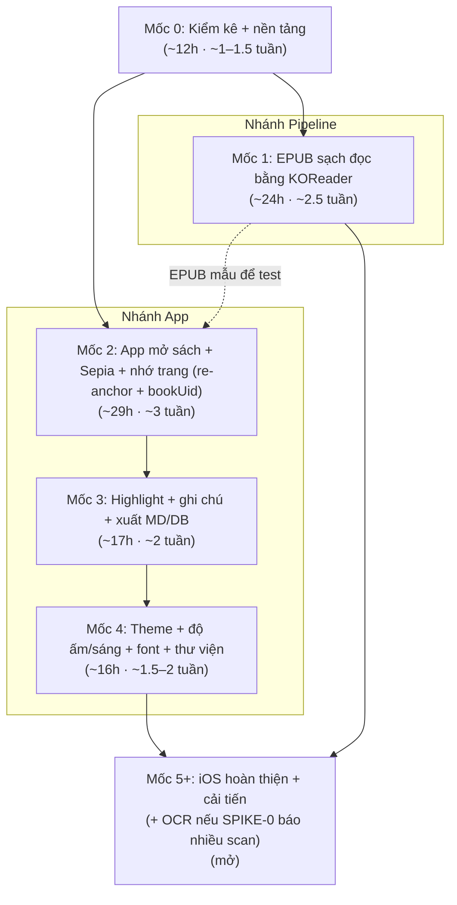

# 07 — Roadmap (kế hoạch theo mốc)

> ~10 giờ/tuần. Chia theo **mốc (milestone)**, mỗi mốc ghi **tổng giờ ước tính** và quy ra **số tuần** ở nhịp 10h/tuần. Mỗi đầu việc có ước tính giờ riêng.
> Nguyên tắc: **mỗi mốc ra một bản dùng được**.
> **Bạn chưa từng build iOS** → mọi việc iOS đã **cộng thêm giờ**.
> Cập nhật: 2026-10-26.

## Hai nhánh song song

- **Nhánh Pipeline**: EPUB xuất ra **đọc kiểm chứng ngay bằng app EPUB có sẵn** (KOReader / Google Play Books / Apple Books) — có giá trị dùng được *trước cả khi* app Sepia xong.
- **Nhánh App**: Sepia thay thế dần app đọc có sẵn.

Hai nhánh chạy xen kẽ (một người), nhưng **không phụ thuộc chặt**: bạn có thể đọc sách đã chuyển bằng KOReader trong khi app Sepia còn đang xây.

---

## Mốc 0 — Kiểm kê kho + nền tảng (gỡ rủi ro) · ~12h (~1–1.5 tuần)

> Không ra tính năng đọc, nhưng là mốc quan trọng nhất về rủi ro. **Bản dùng được** = báo cáo kho PDF + app KMP rỗng chạy 2 OS + quyết định OCR.

- [x] Dựng khung `pdf-pipeline` (uv, PyMuPDF 1.27.x) + `detect.py` (phân loại theo trang/span) + CLI `detect` + test. **2h**
- [x] Quy ước `samples/` + `.gitignore` (samples/ không commit; giữ `tests/fixtures/`). **0.5h**
- [ ] **SPIKE-0** — chạy `detect` trên **vài sách mẫu** (`samples/`), xem phân bố loại (R-11). **~0.5h**
- [ ] **Cửa quyết định OCR**: sách mẫu nhiều scan? → nâng US-A7 lên giai đoạn đầu. **0.5h**
- [x] **SPIKE-2** — app KMP + Compose MP (scaffold tay), build **Android** xanh và **đã chạy trên emulator** (màn hình mở đầu hiện "Sepia", nền sepia). **2h** — Kotlin 2.4.20 / CMP 1.12.2 / AGP 9.4.1 / Gradle 9.8.2; AGP 9 buộc tách `:androidApp` + `:composeApp` (xem [05 ADR-007](./05-tech-decisions.md#adr-007)). *(IDE: cần Android Studio 2026 ≥ Rabbit để sync AGP 9.)*
- [ ] SPIKE-2 (tiếp) — **iOS hoãn** sang việc riêng khi có Xcode: dựng `.xcodeproj` + chạy simulator. **5h** — xem **[issue #3](https://github.com/trinhvandat/sepia/issues/3)** (nên làm **trước phần iOS của SPIKE-1**; liên quan R-02).
- **Thành quả**: khung pipeline + `detect` chạy được, biết cơ cấu sách mẫu + OCR có phải làm sớm không; **app Android rỗng chạy được** (phần iOS hoãn — [issue #3](https://github.com/trinhvandat/sepia/issues/3)).

## Mốc 1 — Pipeline ra EPUB sạch, đọc bằng KOReader · ~24h (~2.5 tuần) · [Pipeline]

> **Bản dùng được**: bạn đọc được sách thật trong kho của mình ở chế độ reflow **ngay trên KOReader**, chưa cần app Sepia.
>
> **Trạng thái (đang làm, CHƯA đạt)**: khung `convert` **chạy được** đầu-cuối (PR #4, chưa merge) và
> EPUB **epubcheck hợp lệ + build tất định**, NHƯNG **chất lượng chưa đạt** trên mẫu duy nhất hiện có —
> `Tự Học Đông Y - Bùi Huy.pdf` hóa ra là **sách scan ABBYY FineReader 11**: mọi trang có **ảnh phủ kín +
> lớp chữ OCR hiển thị** (render mode 0) nằm dưới ảnh. Hệ quả: reflow trộn cột, **mất hình minh hoạ**,
> heading sai (≈421 h3 / 1 h1, có chương ~655 KB). Đang chạy **SPIKE-4** (so với Docling) để quyết hướng
> cho sách scan/nhiều cột trước khi coi Mốc 1 là xong.

- [~] **SPIKE-3** — chuyển mã TCVN3 so dấu bằng mắt (R-03). **4h** — *làm trên dữ liệu **tổng hợp** (`out/spike3_synthetic_tcvn3.txt`) vì `samples/` chưa có sách TCVN3/VNI thật; round-trip khớp 100%. VNI hoãn (chưa có bảng + chưa có mẫu).*
- [x] `extract.py` trích **theo span** (PyMuPDF `get_text("dict", sort=True)`) + SHA-256 + mô hình `model.py`. **3h**
- [x] `legacy_encoding.py` — port bảng TCVN3 (libiconv, dời từ test — một nguồn), NFC, theo span. VNI chưa làm (không có mẫu). **5h**
- [~] `reflow.py` + `toc.py` — **khung xong, chất lượng chưa đạt**: ghép đoạn + bỏ header/footer/số trang chạy; nhưng trên sách scan nhiều cột thì thứ tự đọc lẫn và heading sai. Đang chỉnh (giới hạn độ dài heading, gộp khối chữ-to thành đoạn, chia chương + cắt file theo kích thước). **6h → còn tiếp**
- [x] `build_epub.py` (ebooklib 0.20) + **`dc:identifier` ổn định** + CSS **`font-family: serif` mặc định** (+ cờ `--font-profile` + `font_profiles.toml`) + nhúng trang ảnh (US-A6) + **EPUB tất định từng byte**. **3h**
- [~] `quality.py` kiểm tra nhẹ (whitelist CJK) + **epubcheck** (có Java) — xong. **SPIKE-4** (so Docling, đọc KOReader) **đang làm**; sách scan cho thấy heuristic chưa đủ cho loại này.
- **Thành quả (chưa đạt)**: khung `convert` chạy + EPUB hợp lệ/tất định trên 1 cuốn, **nhưng cuốn đó là scan nên đọc chưa tốt**. Cần: thêm **mẫu chữ sạch** vào `samples/`, hoàn tất SPIKE-4, rồi mới chốt ngưỡng + hướng xử lý scan/nhiều cột.
- ⚠️ **SPIKE-0/mẫu hiện tại chủ yếu là scan có lớp OCR** → đúng cảnh báo R-11: cần nhánh riêng cho sách scan/nhiều cột (Docling hoặc OCR lại). Xem [docs/spikes/spike-4-docling.md](./spikes/spike-4-docling.md).

## Mốc 2 — App mở sách + Sepia + nhớ trang (re-anchor + bookUid) · ~29h (~3 tuần) · [App]

> **Bản dùng được**: mở EPUB trong Sepia trên Android, đọc theme Sepia, nhớ đúng vị trí (kể cả sau khi build lại EPUB).

- [ ] **SPIKE-1** — foliate-js trong WebView + **tự cấu hình asset loader local** (WebViewAssetLoader Android), mở 1 EPUB, lật trang, CFI, chọn đoạn → CFI+prefix/suffix, highlight proto, tải font, **re-anchor bằng `search` foliate-js** (ADR-008) (R-01). **Android: 8h**
- [ ] SPIKE-1 (tiếp) — kiểm tra trên **iOS (WKURLSchemeHandler), time-box tối đa 6h**, không chặn Android; gồm **lớp phủ Compose đè WKWebView + chạm xuyên qua**. **6h**
- [ ] `ReaderEngine` interface + bridge `kmpJsBridge` (loadBook, goTo, currentCfi, applyTheme, reAnchor). **4h**
- [ ] Nhập EPUB vào app (SAF) + **đọc `dc:identifier`→bookUid, khử trùng/thay file theo bookUid** + lưu `Book` (bookUid, contentHash, pipelineVersion) — SQLDelight. **4h**
- [ ] **Theme Sepia** qua CSS; chỉnh cỡ chữ cơ bản. **2h**
- [ ] **Nhớ vị trí đọc** (Book.positionCfi + positionSnippet/prefix/suffix + progress) + **re-anchor trong JS** cho vị trí đọc **và** highlight (ADR-008, chạy khi nhập bản build lại). **5h** *(ước lại — re-anchor + dedup phức tạp hơn bản trước)*
- **Thành quả**: dogfood trên Android; **nhập bản EPUB build lại vẫn giữ vị trí đọc + highlight** (re-anchor).

## Mốc 3 — Highlight, ghi chú, xuất Markdown/DB · ~17h (~2 tuần) · [App]

> **Bản dùng được**: vừa đọc vừa đánh dấu & ghi chú, sao lưu được, không sợ mất dữ liệu.

- [ ] Chọn văn bản → **highlight** (1–2 màu) với CFI range + lưu prefix/suffix/textSnippet/contentHash. **5h**
- [ ] **Ghi chú gõ phím** gắn highlight (trường `note` gộp trong Highlight). **3h**
- [ ] **Xuất Markdown** đúng định dạng ([04-data-model.md](./04-data-model.md) §4), gồm cả highlight orphan. **3h**
- [ ] **Xuất file DB** để sao lưu qua share/SAF. **2h**
- [ ] Hoàn thiện re-anchor (orphan không xóa, vẫn xuất) + test nhập lại nhiều bản build EPUB. **4h** *(ước lại — kiểm thử re-anchor xuyên-build)*
- **Thành quả**: ghi chú khi học, xuất `.md` + DB sao lưu được.

## Mốc 4 — Dịu mắt & thư viện · ~16h (~1.5–2 tuần) · [App]

> **Bản dùng được**: tùy chỉnh đọc thoải mái, quản lý nhiều sách.

- [ ] Đủ **5 theme** (Paper, Sepia, E-ink, Sage, Night) qua CSS tokens. **4h**
- [ ] **Độ ấm** + **độ sáng** bằng **lớp phủ Compose toàn app**, không chặn chạm. **3h**
- [ ] Chỉnh **giãn dòng / lề**; **app chèn font theo `VariantConfig`** (serif + CJK fallback) vào WebView. **3h**
- [ ] Thư viện: thêm/xóa/sắp xếp, hiện **tiến độ đọc**. **4h**
- [ ] Highlight **nhiều màu** đầy đủ (US-D1). **2h**
- **Thành quả**: trải nghiệm "như sách giấy", quản lý được bộ sách.

## Mốc 5+ — iOS hoàn thiện & cải tiến theo trải nghiệm thật · mở

- [ ] **iOS shell (SPIKE-2 phần iOS)** — dựng `.xcodeproj`, chạy vỏ `iosApp` trên simulator → **[issue #3](https://github.com/trinhvandat/sepia/issues/3)**. *Không nhất thiết chờ tới Mốc 5+: nên làm **song song/sớm khi có Xcode**, và **trước phần iOS của SPIKE-1** (Mốc 2).*
- [ ] Hoàn thiện **iOS** (WKURLSchemeHandler ổn định, cử chỉ, hiệu năng) → dùng hằng ngày trên iPhone. *(cộng giờ — lần đầu iOS)*
- [ ] Tinh chỉnh pipeline theo lỗi sách thật (font cũ sót, trang ảnh, bảng).
- [ ] Hiệu ứng lật trang (nếu mượt) + tối ưu NFR-1.
- [ ] Ổn định `ReaderEngine`; cân nhắc tách Gradle module/flavor nếu chuẩn bị app thứ hai (ADR-007).
- [ ] **OCR (US-A7)** — nếu SPIKE-0 đã báo nhiều scan thì phần này **đã nằm ở giai đoạn đầu**, không chờ tới đây.
- **Giai đoạn sau (đóng băng lúc đầu)**: gom ghi chú theo **nhãn/chủ đề người dùng** (US-F1, thêm lại Tag/Topic); **điểm mở rộng tra cứu/từ điển theo lĩnh vực** (US-F2, bật bằng flag); xem PDF gốc trong app (US-F4); **nhân bản sang biến thể khác**. *(Tính năng đặc thù & thương mại hóa của biến thể Đông y — vd tra huyệt, tra Hán Việt, bán cho sinh viên — thuộc [variants/dongy.md](./variants/dongy.md), không phải lõi.)*

---

## Bảng tổng hợp mốc

| Mốc | Nội dung | Nhánh | Tổng giờ | ~Số tuần (10h/tuần) |
|-----|----------|-------|----------|----------------------|
| 0 | Kiểm kê kho + nền tảng (spike) | cả hai | ~12h | ~1–1.5 |
| 1 | Pipeline ra EPUB đọc bằng KOReader | Pipeline | ~24h | ~2.5 |
| 2 | App mở sách + Sepia + nhớ trang (re-anchor + bookUid) | App | ~29h | ~3 |
| 3 | Highlight + ghi chú + xuất MD/DB | App | ~17h | ~2 |
| 4 | Theme + độ ấm/sáng + font + thư viện | App | ~16h | ~1.5–2 |
| **Cộng base (Mốc 0–4)** | | | **~98h** | **~10 tuần** |
| **+ Dự phòng ×1.3–1.5** | rủi ro iOS/foliate-js/re-anchor, ước lạc quan | | **~127–147h** | **~13–15 tuần** |
| 5+ | iOS hoàn thiện + cải tiến (+ OCR nếu cần) | cả hai | mở | — |

> **Lưu ý thực tế**: các con số trên là **ước lạc quan**; iOS lần đầu, foliate-js (API không ổn định) và re-anchor đều nhiều ẩn số. **Dùng khoảng dự phòng ×1.3–1.5 (~13–15 tuần)** để lập kế hoạch thật, đừng chốt theo con số base. Nếu một mốc đuối → **cắt phạm vi**, vẫn ra bản dùng được; nhưng **đừng bỏ SPIKE-0 và SPIKE-1** (cửa quyết định).
> **Scan nhiều (R-11)**: nếu SPIKE-0 cho thấy kho chủ yếu là scan, **Mốc 1 phải lập lại kế hoạch** (thêm OCR), tổng giờ tăng đáng kể — chưa tính trong bảng này.

## Ghi chú nhịp độ
- Mỗi mốc ưu tiên **một lát dọc chạy được** hơn làm xong một lớp theo chiều ngang.
- Nhánh Pipeline cho giá trị **sớm nhất** (đọc bằng KOReader) — ưu tiên để dogfood ngay.
- Phần iOS luôn **time-box** và **không chặn** dogfooding trên Android.
